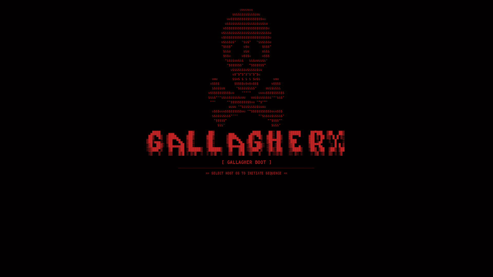

# 🔴 GallagherX Cyberpunk Red GRUB Theme & Secure Boot Dual Boot Guide

> **"Hice este repo porque estuve horas puteando para que el anticheat Vanguard (League of Legends / Valorant) me dejara jugar en Windows 11 teniendo Arch Linux en Dual Boot, y ya que estaba me armé un tema de GRUB hacker con calavera roja y tipografía sangrante que quedó criminal."**



---

## ⚡ ¿Qué hay en este repositorio?

1. **El Tema de GRUB Cyberpunk Red**: Fondo a 1080p con calavera ASCII simétrica, banner con efecto de sangre gótica/goteo, scanlines retro de monitor CRT y barra de progreso roja personalizada.
2. **Guía de Secure Boot con `sbctl`**: Cómo activar Secure Boot de verdad para **Vanguard (LoL / Valorant)** sin romper tu arranque de Linux y sin usar métodos falopa que se caen en cada actualización de kernel.
3. **Generador "Vibe Coding"**: Un script en Python interactivo (`generate_theme.py`) para ponerle tu propio nick o cambiar el logo en 10 segundos sin tocar código.
4. **Modo Manual**: Para los puristas de la terminal que quieren entender cada archivo y hacerlo a mano.
5. **Solución a los dolores de cabeza típicos**: Entradas duplicadas en el booteo, calaveras torcidas en ASCII y resoluciones horribles.

---

## 🎮 Parte 1: El temita de Vanguard y Secure Boot (La posta)

Si tenés Dual Boot (Windows 11 + Arch Linux) y quisiste abrir el LoL o el Valorant, te comiste el cartel de:
`VAN9003: Vanguard requires Secure Boot to be enabled`.

El problema: si activás Secure Boot en la BIOS de prepo, Arch Linux no bootea porque los binarios de Linux no están firmados por las claves de fábrica de Microsoft.

La solución definitiva es usar **`sbctl`** para crear tus propios certificados UEFI y firmar GRUB y el Kernel.

### ⚠️ Los 2 errores fatales que cometen todos:
1. **Correr `sbctl enroll-keys` sin el flag `-m`**: Si te olvidás del `-m`, borrás las claves de Microsoft de tu motherboard y **Windows no te arranca más**. Siempre va con `-m` (`sbctl enroll-keys -m`).
2. **No limpiar las claves en la BIOS primero**: Si tu placa está en *User Mode*, la terminal te va a tirar `Setup Mode is disabled`. Tenés que entrar a la BIOS y darle a *Clear Secure Boot Keys*.

> 👉 **[Leé la guía completa paso a paso de Secure Boot acá](docs/SECURE_BOOT_DUALBOOT_GUIDE.md)** con todos los comandos y explicaciones.

---

## 🚀 Parte 2: Instalación del Tema de GRUB

Podés instalarlo de dos maneras: la rápida (**Modo Vibe Coding**) o la artesanal (**Modo Manual**).

### 🛠️ Opción A: Modo "Vibe Coding" (Automático e Interactivo)

Si no te querés complicar la vida y querés ponerle tu nombre al banner con un generador automático:

1. **Cloná el repo e instalá dependencias:**
   ```bash
   git clone https://github.com/TU_USUARIO/hacker-boot-theme.git
   cd hacker-boot-theme
   sudo pacman -S python-pillow ttf-jetbrains-mono-nerd
   ```

2. **Generá tu fondo personalizado:**
   ```bash
   ./generate_theme.py
   ```
   El script te va a preguntar:
   * Tu Nick o Nombre para el banner ASCII (ej: `GALLAGHERX`, `NEO`, `CYBER`).
   * El estilo de fuente (sangrante gótico `bloody`, bloque limpio `mono12`, etc.).
   * El texto del subtítulo (ej: `[ GALLAGHER BOOT ]`).
   * Si querés usar la calavera roja que viene incluida o una imagen tuya.

3. **Instalalo en el sistema con un solo comando:**
   ```bash
   sudo ./install.sh
   ```
   El instalador:
   * Copia el tema a `/boot/grub/themes/gallagherx`.
   * Hace un backup seguro de tu `/etc/default/grub`.
   * Configura la resolución en 1080p y activa el tema.
   * Ejecuta `grub-mkconfig` automáticamente.

---

### 💻 Opción B: Modo Manual (Paso a paso para puristas)

Si preferís hacer todo a mano como buen usuario de Arch:

1. **Instalá las fuentes necesarias:**
   ```bash
   sudo pacman -S ttf-jetbrains-mono-nerd
   ```

2. **Creá la carpeta del tema y copiá los archivos:**
   ```bash
   sudo mkdir -p /boot/grub/themes/gallagherx
   sudo cp -r grub/* /boot/grub/themes/gallagherx/
   ```

3. **Editá `/etc/default/grub`:**
   ```bash
   sudo nano /etc/default/grub
   ```
   Asegurate de tener estas dos líneas configuradas:
   ```bash
   GRUB_THEME="/boot/grub/themes/gallagherx/theme.txt"
   GRUB_GFXMODE="1920x1080,auto"
   ```

4. **Regenerá el archivo de configuración de GRUB:**
   ```bash
   sudo grub-mkconfig -o /boot/grub/grub.cfg
   ```
   Reiniciá la máquina y ya tenés el bootloader listo.

---

## 💀 Parte 3: ¿Cómo crear o cambiar el Arte ASCII?

En este tema no usamos una imagen estática bajada de Google. El banner y los logos están hechos con matrices ASCII en alta fidelidad y efecto CRT.

Si querés buscar o crear tus propios ASCII:
* **Generadores de texto:** Usá [TAAG](https://patorjk.com/software/taag/) con fuentes como `Bloody`, `Slant` o `Mono12`.
* **Colecciones de dibujos:** Revisá [ASCII Art Archive](https://www.asciiart.eu/) (calaveras, dragones, espadas, etc.).

### 🚨 La trampa de la "Calavera Torcida"
Si alguna vez intentaste escribir un script para centrar arte ASCII y te quedó la calavera chueca o desalineada, es porque **centraste cada línea de forma individual**. 

Como cada línea de arte ASCII tiene una cantidad distinta de espacios vacíos al principio, centrar línea por línea descoloca todo. **La clave está en calcular el ancho máximo de todo el bloque y arrancar todas las líneas en el mismo punto X.**

> 👉 **[Leé la Guía de Arte ASCII y Centrado Matemático acá](docs/ASCII_ART_GUIDE.md)** para ver el código en Python exacto y cómo evitar que las letras se peguen.

---

## 🔧 Solución de Errores Comunes

* **¿Te aparecen dos o tres opciones iguales de "Arch Linux" en el booteo?**  
  Pasa si tu sistema genera UKIs (Unified Kernel Images). El script `15_uki` las duplica.  
  Se soluciona con: `sudo chmod -x /etc/grub.d/15_uki && sudo grub-mkconfig -o /boot/grub/grub.cfg`.
* **¿El menú de GRUB se ve gigante y pixelado?**  
  Tu monitor no está levantando 1080p en GRUB. Agregá `GRUB_GFXMODE="1920x1080,auto"` en `/etc/default/grub`.
* **¿Te bloqueó la terminal con `pam_faillock` (3 incorrect password attempts)?**  
  Desbloqueate al toque corriendo: `faillock --reset`.

> 👉 **[Revisá la guía completa de solución de errores acá](docs/FIXING_GRUB_ERRORS.md)**.

---

## 📂 Estructura del Proyecto

```text
├── assets/
│   ├── ascii_templates/   # Diccionarios de fuentes ASCII y plantillas de calaveras
│   ├── previews/          # Capturas de pantalla reales del menú
│   └── skull_red.png      # Calavera en alta definición roja
├── docs/
│   ├── ASCII_ART_GUIDE.md           # Cómo armar y centrar arte ASCII sin deformarlo
│   ├── FIXING_GRUB_ERRORS.md        # Fixes a entradas duplicadas, UKIs y resolución
│   └── SECURE_BOOT_DUALBOOT_GUIDE.md# Guía paso a paso sbctl + Vanguard + Windows 11
├── generate_theme.py      # Generador interactivo de backgrounds en Python (Modo Vibe Coding)
├── grub/
│   ├── background.png     # Fondo generado listo para usar (1920x1080)
│   ├── jetbrains_*.pf2    # Fuentes convertidas para el renderizador de GRUB
│   ├── select_*.png       # Texturas de la caja de selección roja
│   └── theme.txt          # Archivo de configuración oficial del tema
├── install.sh             # Script instalador automático con backup
├── LICENSE                # Licencia MIT
└── README.md
```

---

## ⭐ Créditos y Contribuciones

Hecho a pulmón para la comunidad de Arch Linux y gamers que no quieren resignar su sistema operativo para jugar unas partidas. Si te sirvió, dejale una estrellita ⭐ al repo en GitHub. ¡PRs y nuevos estilos de ASCII son más que bienvenidos!
